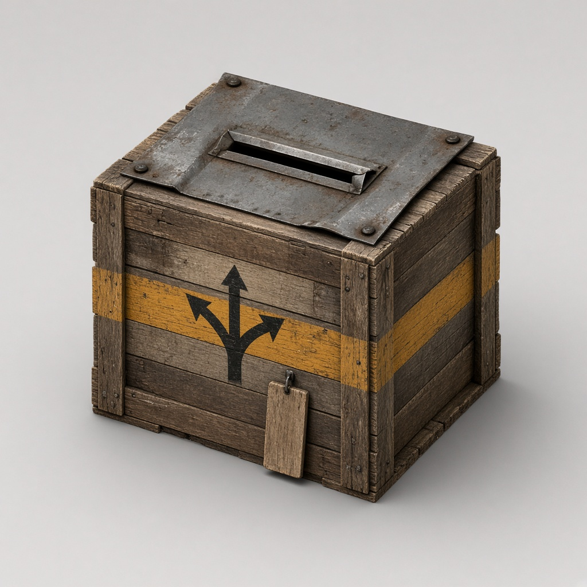

# PZSorter

A Project Zomboid (Build 42) mod that adds a **Sorter Crate**: drop your loot in one box, hit **Sort**, and everything goes to the right shelf, crate, fridge, or freezer in your base.


*Concept art for the Sorter Crate.*

> Status: step 3 (this branch) can build and name a Sorter Crate, assign containers, filter them by inventory category, and sort. Single items, Preview, and copy/paste are not in yet.

## How it works

1. **Build a Sorter Crate.** It looks like a wooden crate with a metal drop slot on top, a yellow stripe, and a branching-arrow stencil.
   - 4 Planks, 10 Screws, 1 Small Metal Sheet
   - Carpentry 1
   - Tools: Hammer and Screwdriver (not consumed)
   - Holds only 50 capacity, so it's a sorting tool, not extra storage.
2. **Name it** when you place it, like "Main Base" or "Farm".
3. **Assign containers.** Right-click any existing storage (crates, shelves, fridges, freezers, and so on) and choose **Assign to Sorter**. Only containers you assign are used. Each one must be within the sorter's range (20 tiles by default). A fridge and freezer on one tile are two rows. **Open Sorter** on the crate lists them.
4. **Set filters.** Each row has a priority (1 to 9, default 5) and **Edit filter**. Tick whole inventory categories such as **Food** or **Tool**. Allow All and Clear All are on that list. A row with nothing ticked says **No filter** and receives nothing. Picking single items inside a category comes later.
5. **Sort.** Press **Sort** on the panel, or right-click the Sorter Crate and choose **Sort**. Your character stays at the crate while the items move. Anything that doesn't match, or doesn't fit, stays in the Sorter Crate. A short summary says what moved and what stayed.

## Rules

- **A specific item beats a category.** If one box takes "Hammer" and another takes all "Tools", hammers go to the first.
- **Priority breaks ties.** Each assigned container has a priority, and the higher one wins.
- **Full containers overflow** to the next matching container. If nothing has room, the item stays in the Sorter Crate.
- **Skipped items:** equipped, favorited, and key items are never moved. Bags move as whole items and aren't emptied.
- After sorting you get a short summary, like "Sorted 38, 4 left: Freezer full."

## Sandbox options

- **Sorter range:** 20 to 30 tiles (default 20).
- **Sort speed:** realistic timed action, or instant.

## Planned extras

- "Copy from contents" sets a container's filter from what it already holds.
- Search, and ticking single items, in the filter tree. Allow All and Clear All are already on the category list.
- Preview, renaming, and a second player sorting the same crate. Assigning already checks safehouse membership: outside a safehouse anyone can use a sorter, and inside one only members can. Item moves already run on the server.

## Install and test

Project Zomboid Build 42.21. The full click-by-click list is [docs/TESTING.md](docs/TESTING.md).

One-time setup, in a Windows Command Prompt:

```
cd C:\AI\Projects
git clone https://github.com/wesdebas/PZSorter.git
mklink /J "%USERPROFILE%\Zomboid\Workshop\PZSorter" "C:\AI\Projects\PZSorter"
```

That links the repo into the game's Workshop folder. Do not also subscribe to PZSorter on Steam, and do not keep a second copy under `Zomboid\mods`.

For this branch:

```
cd /d C:\AI\Projects\PZSorter
git fetch
git checkout feature/category-sort
git pull
```

Enable **PZSorter** in the Mods menu, start a Sandbox game, and use the checklist in [docs/TESTING.md](docs/TESTING.md). The final crate art is in. Facings 2 (W) and 3 (N) show the crate's back on purpose.

The Lua tests run on GitHub for every pull request. You do not need to run them. From a machine with Lua 5.1 and busted they are `busted --helper=tests/helper.lua tests`.

## License

MIT. Use it, change it, and share it freely. See [LICENSE](LICENSE).
